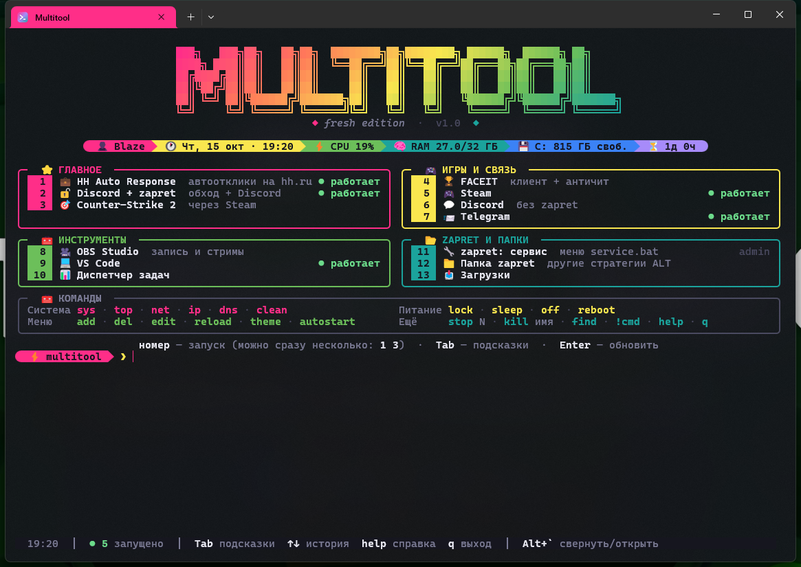

# ⚡ Fresh Multitool

Красивый лаунчер программ в отдельном окне Windows Terminal: градиентный баннер, powerline-строка
с состоянием системы, цветные секции, индикаторы «● работает», автодополнение по Tab и набор
полезных системных команд. Всё меню настраивается одним файлом `config.json`, изменения
подхватываются сразу, без перезапуска.



## Как открыть

| Способ | Что делает |
| --- | --- |
| `fresh_multitool` или `mt` в cmd / PowerShell / Win+R | открывает отдельное окно (или переключает на уже открытое) |
| **Alt+`** (клавиша `ё`) из любого места | открыть / свернуть Multitool |
| Пуск → «Fresh Multitool» | то же, что `fresh_multitool` |
| Вход в Windows | окно открывается само (автозапуск) |
| `fresh_multitool --here` | запустить прямо в текущей консоли |

## Управление

- **Номер пункта** + Enter запускает программу. Можно несколько сразу: `1 3`.
- **Алиасы и названия** тоже работают: `cs`, `hh`, `tg`, `telegram`.
- **Tab** открывает подсказки, **↑↓** листают историю, **Enter** на пустой строке обновляет экран.
- Экран сам обновляется каждые 20 с: время, CPU, индикаторы запущенных программ.

### Встроенные команды

| Команда | Что делает |
| --- | --- |
| `stop N` | закрыть программу пункта N (например, `stop 2` выключает zapret) |
| `kill имя` | завершить процесс по имени: `kill chrome` |
| `find слово` | найти программу в меню Пуск |
| `sys` | процессор, видеокарты, память, диски |
| `top` | процессы, которые едят больше всего памяти |
| `net` | доступны ли Discord, YouTube, Google, Steam… (проверка, работает ли zapret) |
| `ip` | локальный и внешний IP |
| `dns` | сбросить DNS-кэш |
| `clean` | очистить `%TEMP%` (спросит подтверждение) |
| `lock` · `sleep` · `reboot` | блокировка, сон, перезагрузка |
| `off` · `off 30` · `off cancel` | выключить сейчас, через 30 минут, отменить |
| `add [путь или название]` | мастер добавления программы, сайта или папки |
| `del N` | убрать пункт из меню |
| `edit` | открыть `config.json` в VS Code (или Блокноте) |
| `theme [имя]` | темы: `fresh`, `neon`, `sunset`, `ocean`, `dracula`, `matrix` |
| `autostart on/off` | запуск вместе с Windows |
| `!команда` | выполнить команду cmd прямо здесь: `!ipconfig` |
| `help` · `q` | справка · выход |

## Настройка `config.json`

Проще всего добавлять программы командой `add`: можно перетащить файл в окно или написать
название, например `add obs`, и Multitool сам найдёт её в меню Пуск. Для тонкой настройки
открой `edit`: в VS Code работают подсказки полей (схема `config.schema.json`).

Пункты нумеруются автоматически по порядку. Чтобы закрепить за пунктом свою клавишу, укажи поле `key`.

```jsonc
{
  "name": "Counter-Strike 2",          // название в меню
  "icon": "🎯",                         // эмодзи
  "description": "через Steam",         // серая подпись
  "path": "steam://rungameid/730",      // exe, bat, lnk, папка, https://, steam://
  "args": "--fullscreen",               // аргументы (строкой или списком)
  "cwd": "D:\\Games",                   // рабочая папка (по умолчанию папка файла)
  "admin": false,                       // запускать от администратора
  "window": "normal",                   // normal | minimized | maximized | hidden
  "process": "cs2.exe",                 // для «● работает» и команды stop
  "aliases": ["cs", "кс"],              // короткие имена
  "autostart": false                    // запускать вместе с Multitool при входе в Windows
}
```

**Несколько действий подряд** (`steps`). Так устроен пункт «Discord + zapret»: zapret стартует,
только если ещё не запущен, а пауза перед Discord пропускается, если zapret уже работал.

```jsonc
"steps": [
  { "path": "C:\\...\\general (ALT9).bat", "admin": true, "window": "minimized", "unless_running": "winws.exe" },
  { "wait": 3 },
  { "path": "%LOCALAPPDATA%\\Discord\\Update.exe", "args": "--processStart Discord.exe" }
]
```

**Команда cmd** вместо программы: `"command": "ipconfig /all"` выполнится прямо в окне Multitool.
С `"admin": true` она откроется в отдельном окне с правами администратора.

В путях работают переменные окружения: `%APPDATA%`, `%LOCALAPPDATA%`, `%USERPROFILE%`.
Обратный слэш в JSON пишется двойным: `C:\\Games`, или используй прямой: `C:/Games`.

### Общие настройки (`settings`)

| Поле | По умолчанию | Описание |
| --- | --- | --- |
| `title` / `subtitle` | `MULTITOOL` / `fresh edition` | текст баннера |
| `theme` | `fresh` | цветовая тема |
| `banner_font` | `ansi_shadow` | шрифт баннера (pyfiglet: `slant`, `doom`, `big`…) |
| `hotkey` | ``Alt+` `` | глобальная клавиша, например `Ctrl+Alt+T`, `Win+F1` |
| `open_on_startup` | `true` | открывать окно при входе (иначе в фоне только горячая клавиша) |
| `auto_refresh` | `20` | автообновление экрана, секунд (0 — выкл.) |
| `close_after_launch` | `false` | закрывать Multitool после запуска программы |
| `window` | `124×40`, по центру | размер окна в символах |
| `editor` | `auto` | `auto`, `code`, `notepad` или путь к редактору |
| `autostart_delay` | `0` | задержка автозапуска, секунд |
| `net_targets` | Discord, YouTube… | сайты для команды `net` |
| `show_status_bar`, `show_descriptions`, `show_commands`, `powerline` | `true` | что показывать |

### Своя тема

```jsonc
"themes": {
  "mytheme": {
    "gradient": ["#FF0080", "#7928CA", "#00DFD8"],   // баннер
    "accents": ["#FF0080", "#7928CA", "#00DFD8"],    // секции меню
    "bar": ["#FF0080", "#B03CE0", "#7928CA", "#00DFD8"] // статус-строка
  }
}
```

Затем `theme mytheme`.

## Установка и удаление

`install.cmd` ставит библиотеки (`rich`, `prompt_toolkit`, `psutil`, `pyfiglet`) и подключает
Multitool к системе:

- папка `bin` попадает в PATH пользователя, поэтому команды `fresh_multitool` и `mt` работают из любого места;
- в Windows Terminal появляется профиль «Fresh Multitool» со своей цветовой схемой (через fragment, твой `settings.json` не меняется);
- в меню Пуск появляется ярлык, в автозагрузке — ярлык автозапуска;
- запускается фоновый процесс горячей клавиши (`pythonw`, около 20 МБ памяти).

`install.cmd --no-autostart` ставит без автозапуска. `uninstall.cmd` убирает всё это из системы
и не трогает файлы проекта.

## Если что-то не так

- **Горячая клавиша не срабатывает.** Multitool покажет предупреждение, если сочетание занято
  другой программой. Поменяй `settings.hotkey`: новое подхватится за 5 секунд.
- **Нет цветов.** Проверь, не задана ли переменная окружения `NO_COLOR`.
- **Окно сразу закрылось.** Текст ошибки лежит в `multitool.log`.
- **Сломался `config.json`.** Multitool покажет строку с ошибкой и предложит `edit`. Предыдущая
  версия файла сохраняется в `config.json.bak`.

## Структура

```
multitool.py         точка входа (--open, --here, --install, --uninstall)
config.json          меню и настройки
config.schema.json   подсказки полей для VS Code
bin/                 fresh_multitool.cmd и mt.cmd (в PATH)
mt/app.py            главный цикл, ввод, автодополнение
mt/commands.py       встроенные команды
mt/ui.py             баннер, статус-строка, меню
mt/launcher.py       запуск программ и шагов, статусы процессов
mt/tools.py          sys, top, net, ip, очистка, питание
mt/integration.py    окно Терминала, автозапуск, горячая клавиша, установка
mt/winsys.py         WinAPI: ShellExecute, окна, PATH, ярлыки
mt/themes.py         темы и градиенты
tools/make_icon.py   генератор иконки assets/multitool.ico
```
